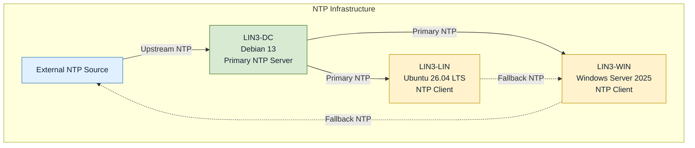

# LIN3

LIN3 is a centralized Network Time Protocol (NTP) infrastructure designed to provide reliable and consistent time synchronization across Linux and Windows systems. It uses a primary Debian-based NTP server with secondary time sources configured to maintain synchronization in the event of a server failure.
## Description

The LIN3 infrastructure is built around LIN3-DC, a Debian 13 server acting as the primary internal NTP server. LIN3-DC synchronizes its clock with an external NTP source and distributes accurate time to the other systems within the infrastructure.

The environment consists of three machines:

    LIN3-DC (Debian 13): Primary NTP server, synchronized with an external time source.
    LIN3-WIN (Windows Server 2025): Primary synchronization through LIN3-DC, with the external NTP source configured as a secondary source.
    LIN3-LIN (Ubuntu 26.04 LTS): Primary synchronization through LIN3-DC, with LIN3-WIN configured as its secondary source.

The infrastructure is designed with redundancy and availability in mind. If LIN3-DC becomes unavailable, LIN3-WIN can fall back to the external NTP source, while LIN3-LIN can use LIN3-WIN as its alternative time source. When the primary server becomes available again, the systems should resume synchronization according to their configured source preferences.

This architecture provides a centralized time synchronization service while maintaining an alternative synchronization path in case of primary server failure.

## Infrastructure Diagram

The following diagram illustrates the NTP synchronization hierarchy and the configured fallback paths.



## Getting Started

### Dependencies

* Describe any prerequisites, libraries, OS version, etc., needed before installing program.
* ex. Windows 10

### Installing

* How/where to download your program
* Any modifications needed to be made to files/folders

### Executing program

* How to run the program
* Step-by-step bullets
```
code blocks for commands
```

## Help

Any advise for common problems or issues.
```
command to run if program contains helper info
```

## Authors

Contributors names and contact info


Leo-jaquier
[@Leo-jaquier](https://github.com/leo-jaquier)

PS45HVT
[@PS45HVT](https://github.com/PS45HVT)

SvenRaval
[@SvenRaval](https://github.com/SvenRaval)


## License

This project is licensed under the MIT License - see the LICENSE.md file for details
